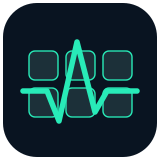

<p align="center"></p>

# MashKeys

Music for your MacBook keyboard. Smooth, full-range music pulses that follow the music’s pace and volume—with live drop accents, local speech filtering, and a global **⌘⌥K** toggle.

**[Download MashKeys](https://github.com/Nile54/mashkeys/releases/latest)** · [Privacy](docs/privacy.md)

**One app, no browser extension.** MashKeys captures system audio from all apps and websites automatically. There are no tab connections or browser-helper setup steps.

MashKeys is a standalone Swift app. It does not require or install another keyboard visualizer, virtual audio driver, Python service, or cloud account.

## Install

1. Download the latest `.dmg`, open it, and drag **MashKeys** into **Applications**.
2. Open MashKeys. Choose **Enable MashKeys** and allow system-audio access when macOS asks.
3. Play music from YouTube, Music, Spotify, Voicemod, or another app. The keyboard icon in the menu bar controls MashKeys.
4. Press **⌘⌥K** from any app to turn the lights on or off. **⌘Q** still quits the foreground app normally.

The public build is ad-hoc signed, **not Apple-notarized**. On first download, macOS may block opening it. After trying to open it, use **System Settings → Privacy & Security → Open Anyway**, only if you trust this project. Do not disable Gatekeeper globally. You can also build from source below. Release assets have SHA-256 checksums.

If audio access was denied, enable MashKeys under **Privacy & Security → Screen & System Audio Recording**, then toggle it on again. The exact pane label varies with macOS.

## How the lights behave

- Choose **Bass / kicks**, **Mids / vocals**, **Treble / hi-hats**, or **Full mix** as the beat source. These follow intensity changes in the selected frequencies; they do not separate instruments.
- Adjust **Sensitivity** from fewer to more pulses. Higher values detect softer crests and recover sooner, so more hits become visible. Lower values favor strong accents with longer recovery. **Bass at 50%** preserves the original tuning.
- Enable **Auto-sync** in the keyboard menu, or **Auto-sync new music** in Settings, to run song sync automatically. It syncs when rhythmic audio begins, re-arms after about two seconds of quiet, and rechecks continuous playback about once a minute. This uses audio rather than track titles, so gapless song changes are handled by periodic refresh rather than exact track detection. Manual slider edits or Cancel hold automation until the next quiet gap; toggling Auto-sync off and on also re-arms it. The preference is saved and defaults off.
- Click **Sync to song** while music plays to sample about **8 seconds** of the selected beat source and suggest a sensitivity for clear, smooth pulses. It applies and saves the result automatically. Cancel or move the slider to take over. Silence, filtered speech and unclear rhythms leave your setting unchanged. It tunes the current section; it does not recognize the song or guarantee one perfect setting for every section.
- All keys dip to **0%** and ease back to **100%**. This is a single white backlight, not per-key RGB.
- Faster rhythms recover faster; stronger hits linger longer. The upward fade can last up to about **2.2 seconds**.
- A pronounced bass-energy lift or bass returning after a musical break can interrupt an ordinary pulse.
- Ordinary overlapping hits finish their fade, preventing continuous rapid strobing.
- Audio is measured live in short windows. Normal lighting needs no song recognition, sync, replay, or track download. Sync is an optional adjustment, run by the button or the saved Auto-sync preference.

**Ignore talking** is on by default. Only confident recent speech blocks pulses. Singing and rap remain eligible, and unknown music is allowed immediately. A sound classifier needs roughly half a second of audio to decide: a brief initial speech pulse is possible, and mixed speech/music can be misclassified. This is not a perfect voice separator or an understanding of musical structure.

Stopping or quitting restores your previous brightness, automatic-brightness setting and idle dimming. Start at login is optional in the menu.

## Music lights and app exclusions

Open **MashKeys → Settings**. **Music lights — all apps and websites** is the main on/off switch. It stays in sync with the menu and **⌘⌥K** shortcut. When on, YouTube and other websites are eligible automatically. Beat source and sensitivity apply live, are saved for the next launch, and do not restart audio capture.

Check an app under **Ignore whole apps (checked = ignored)** to exclude its audio from lighting. The app stays audible, and helper processes are covered. Changing app rules or starting a newly allowed app may briefly rebuild the filtered capture.

**Individual website exclusions are unavailable.** The native audio capture does not provide website identities for the browser mix. Earlier releases offered manually connected browser tabs, which excluded unchecked sites unless connected too; that mode and its extension have been removed. Old website selections never exclude Chrome from capture. If you installed the old extension, remove **MashKeys Tab Audio** from your browser; MashKeys does not use it.

On upgrading, MashKeys removes its obsolete local browser-host registration and ignores the old connected-tabs setting. Speech filtering, app exclusions and login preferences are preserved.

## Compatibility

- macOS **14.2 or later**, Apple Silicon or Intel; the download is universal.
- A Mac with a supported built-in, adjustable keyboard backlight.
- Tested on an **M5 MacBook Pro running macOS 27**. Other models and OS versions are not exhaustively hardware-tested.
- External RGB keyboards, Magic Keyboard lighting, and individually addressed keys are not supported.

Keyboard brightness uses Apple’s **private CoreBrightness framework** because there is no public per-frame backlight API. A macOS update may change it. Unsupported hardware reports an error instead of pretending that LEDs changed.

## Build and test

Install Apple’s Command Line Tools (`xcode-select --install`), then:

```sh
git clone https://github.com/Nile54/mashkeys.git
cd mashkeys
./scripts/test.sh
./scripts/build.sh
open .build/MashKeys.app
```

`build.sh` builds both CPU architectures, generates the original icon and signs the standalone app ad hoc. To use your own signing certificate, set `CODESIGN_IDENTITY`. No signing credentials are included in this repository. `./scripts/package.sh` creates the DMG, ZIP and checksums in `dist/`.

Tests generate their own signals; no user song or captured audio is distributed. They cover first-play bass response, smooth full-depth recovery, tempo/volume adaptation, live drop accents, gain changes, irregular audio buffers, speech decision policy, frequency-band selection, sensitivity, live source changes, saved settings, song-sync content adaptation, gain invariance, cancellation, timeout, automatic starts/rearming, periodic refresh, manual override, disable races, silence/speech rejection, whole-app rules and legacy website-setting regression coverage. CI builds the universal app. Automated tests do **not** prove optical LED timing or compatibility with every Mac.

For an additional local classifier check, run `./scripts/test-audio.sh spoken-44100.wav music-44100.wav` with your own 44.1 kHz files. This analyzes them without playing, recording, or uploading them.

## Source map

| Component | Purpose |
| --- | --- |
| `Core.swift` | Sources, sensitivity, crest detection, contrast, adaptive rise and speech policy |
| `AudioSpectrum.swift` | Selected frequency-band envelope from a 2048-point FFT, every 256 samples |
| `SongSync.swift` | Bounded eight-second spectral sampling and background sensitivity recommendation |
| `AudioTap.swift` | System capture, allowed-process mixes and output-device changes |
| `SpeechGuard.swift` | Bounded, on-device SoundAnalysis worker |
| `KeyboardBacklight.swift` / `LightAnimator.swift` | Hardware snapshots, immediate writes and smooth recovery |
| `Rules.swift` / `SettingsWindow.swift` | System-wide toggle and app exclusions |
| `LegacyBrowserCleanup.swift` | Removal of obsolete local browser-host registrations |
| `GlobalShortcut.swift` | Carbon registration of ⌘⌥K, without keystroke monitoring |

Audio capture uses [Apple’s CoreAudio process taps](https://developer.apple.com/documentation/coreaudio/capturing-system-audio-with-core-audio-taps); speech checks use [SoundAnalysis](https://developer.apple.com/documentation/soundanalysis).

MIT licensed. Built by Nilesh Nandakumar.
